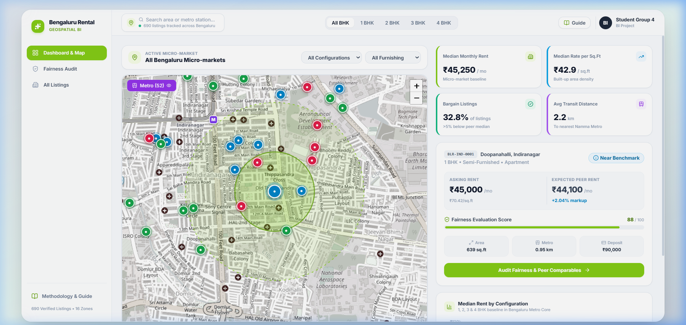
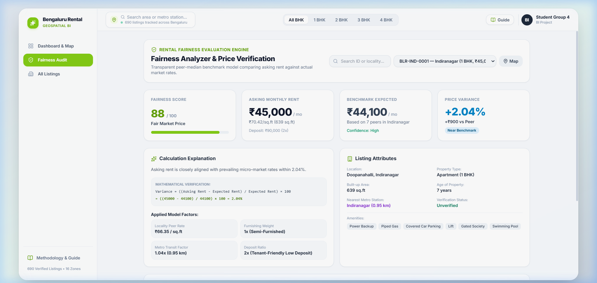
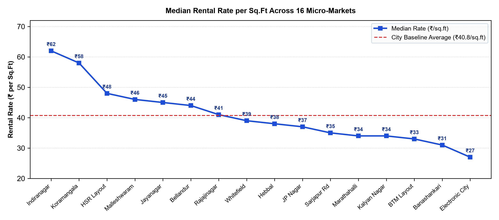

# Bengaluru Rental Intelligence — Geospatial BI Platform

[](https://fastapi.tiangolo.com)
[](https://www.python.org/)
[](https://react.dev/)
[](https://www.typescriptlang.org/)
[](https://tailwindcss.com/)
[](https://leafletjs.com/)

> **Academic Business Intelligence (BI) Project**  
> An explainable geospatial analytics and decision-support engine engineered to detect rental pricing inefficiencies, assess transit accessibility, and evaluate market fairness across Bengaluru's tech corridors.

---

## Visual Showcase

### 1. Interactive Geospatial Dashboard
A high-density operational view combining a live GIS cartography map (690 verified properties + 52 Namma Metro stations across Purple and Green lines), quick-filtering BHK controls, micro-market aggregate KPI cards, a selected property spotlight, and configuration median benchmarks.



---

### 2. Explainable Fairness Audit Breakdown
Rather than relying on uninterpretable "black box" machine learning models, the platform computes an empirical, auditable fairness score ($0\text{--}100$) derived from peer medians, square-footage baselines, furnishing premiums, and metro transit proximity.



---

### 3. Locality Rental Rate Benchmarks
Comparative micro-market analysis displaying median rental rates per square foot across 16 major residential and IT employment hubs across Bengaluru.



---

## Key Capabilities & BI Modules

| Module | Core Functionality | Business Intelligence Value |
| :--- | :--- | :--- |
| **Interactive GIS Map** | Live Leaflet map with custom SVG markers, radar focus rings, metro line toggles, and station proximity buffers. | Geospatial clustering & spatial transit accessibility analysis. |
| **Key Market Stats** | Real-time aggregate KPI cards: Median Rent, Median ₹/Sq.Ft, % Bargain Listings, and Avg Transit Distance. | Macro and micro-market affordability tracking. |
| **Property Spotlight** | Instant single-listing inspection card with benchmark delta, deposit ratio, and one-click fairness audit trigger. | Rapid ad-hoc property screening for tenants and analysts. |
| **BHK Rate Breakdown** | Dynamic Recharts bar visualizations comparing 1, 2, 3, and 4 BHK rates within the active filtered locality. | Configuration elasticity & tier distribution insights. |
| **Fairness Analyzer** | In-depth audit modal computing transparent mathematical equations, factor adjustments, and comparable peers. | Defensible, explainable valuation without black-box bias. |
| **Property Directory** | High-performance searchable, filterable, and sortable table of all 690 verified micro-market listings. | Granular data exploration and tabular export capability. |

---

## Mathematical Formulation of the Fairness Model

### 1. Expected Rent Peer Baseline
Expected rent is calculated using a hierarchical fallback heuristic that matches listings with similar market comparables:
1. **Tier 1 (Strict Match)**: Same Locality $\cap$ Same BHK $\cap$ Same Furnishing Status
2. **Tier 2 (Relaxed Match)**: Same Locality $\cap$ Same BHK (with empirical furnishing adjustment)
3. **Tier 3 (Locality Fallback)**: Locality Median ₹/sqft $\times$ Super Built-up Area
4. **Tier 4 (Citywide Fallback)**: Citywide BHK Median

$$\text{Expected Rent} = \text{Area (sqft)} \times \text{Peer Median Rate (₹/sqft)} \times \text{Furnishing Factor} \times \text{Transit Factor}$$

### 2. Percentage Variance Formulation
$$\text{Variance (\%)} = \left( \frac{\text{Asking Rent} - \text{Expected Rent}}{\text{Expected Rent}} \right) \times 100$$

### 3. Transparent Scoring Matrix
* **Variance $\le -15\%$** $\rightarrow$ **Score 95–100** *(Exceptional Bargain / High Value)*
* **$-15\% < \text{Variance} \le 0\%$** $\rightarrow$ **Score 88–94** *(Good Value)*
* **$0\% < \text{Variance} \le 5\%$** $\rightarrow$ **Score 84–90** *(Fair Market Equilibrium)*
* **$5\% < \text{Variance} \le 18\%$** $\rightarrow$ **Score 60–80** *(Slightly Overpriced)*
* **Variance $> 18\%$** $\rightarrow$ **Score $< 60$** *(Significantly Overpriced)*

### 4. Transit Proximity (Haversine Formula)
Every listing calculates its great-circle geodesic distance to all 52 Namma Metro stations to determine walkable transit suitability ($\le 1.5\text{ km}$):

$$d = 2R \arcsin \left( \sqrt{\sin^2\left(\frac{\Delta \phi}{2}\right) + \cos(\phi_1)\cos(\phi_2)\sin^2\left(\frac{\Delta \lambda}{2}\right)} \right)$$

---

## Technology Stack

```
                          ┌───────────────────────────┐
                          │   React 19 + TypeScript   │
                          │   Tailwind CSS + Lucide   │
                          │  Leaflet GIS + Recharts   │
                          └─────────────┬─────────────┘
                                        │ HTTP / JSON
                                        ▼
                          ┌───────────────────────────┐
                          │     FastAPI (Python)      │
                          │   Pydantic v2 Validation  │
                          │  Pandas Statistical Engine│
                          └─────────────┬─────────────┘
                                        │ Data Ingestion
                                        ▼
                          ┌───────────────────────────┐
                          │   Cleaned CSV Datastores  │
                          │  • rentals.csv (690 rows) │
                          │  • metro_stations.csv (52)│
                          └───────────────────────────┘
```

* **Frontend**: React 19, TypeScript, Vite, Tailwind CSS (Custom Dark Slate + Lime `#84cc16`), Leaflet & React Leaflet, Recharts, Axios, Lucide Icons.
* **Backend**: FastAPI, Python 3.10+, Pandas, NumPy, Pydantic v2, Uvicorn ASGI.
* **Datasets**:
  * `backend/data/rentals.csv`: 690 curated property listings across 16 authentic Bengaluru micro-markets.
  * `backend/data/metro_stations.csv`: 52 real Namma Metro stations (Purple & Green Lines) with exact coordinates.

---

## Quick Start (Running Locally)

### Prerequisites
* **Node.js** (v18 or higher)
* **Python** (v3.10 or higher)

### Method A: One-Click Startup (Windows)
Double-click `run.bat` in the repository root, or run:
```cmd
run.bat
```
*This launches both the FastAPI backend (`http://localhost:8000`) and the Vite React frontend (`http://localhost:5173`) in dedicated terminal windows.*

---

### Method B: Manual Step-by-Step Setup

#### 1. Backend Service
```bash
# Navigate to backend
cd backend

# Activate virtual environment (Windows)
..\venv\Scripts\activate

# Install requirements (if running fresh)
pip install fastapi uvicorn pandas numpy pydantic

# Start FastAPI server
python -m uvicorn main:app --host 127.0.0.1 --port 8000 --reload
```
* API Server: [http://127.0.0.1:8000](http://127.0.0.1:8000)
* Interactive Swagger Docs: [http://127.0.0.1:8000/docs](http://127.0.0.1:8000/docs)

#### 2. Frontend Client
```bash
# Navigate to frontend (in a separate terminal)
cd frontend

# Install dependencies
npm install

# Start Vite development server
npm run dev
```
* Web Dashboard: [http://localhost:5173](http://localhost:5173)

---

## API Endpoints Reference

| Method | Endpoint | Description |
| :--- | :--- | :--- |
| `GET` | `/api/properties` | Retrieve listings with query filters (`locality`, `bhk`, `min_price`, `max_price`, `status`). |
| `GET` | `/api/properties/{id}` | Retrieve individual listing details with expected rent peer calculation. |
| `GET` | `/api/properties/{id}/fairness` | Full explainable audit breakdown with factor weights and comparable peers. |
| `GET` | `/api/analytics/overview` | Aggregated market indicators, KPI metrics, and price distributions. |
| `GET` | `/api/metro-stations` | GeoJSON-compatible list of 52 operational Namma Metro stations. |

---

## Validation & Test Suite

### Backend Unit Tests
```bash
cd backend
..\venv\Scripts\python -m unittest tests/test_api.py
```
*Executes assertions validating 690 listing records, fallback rent calculation mechanics, score boundary conditions, and geospatial distance tolerances.*

### Frontend Production Typecheck & Build
```bash
cd frontend
npm run build
```
*Runs strict TypeScript compiler (`tsc -b`) and Vite production bundler.*

---

## Project Directory Structure

```
bengaluru_rental_intelligence/
├── assets/                         # Visual screenshots for documentation
│   ├── dashboard.png               # Full geospatial BI dashboard view
│   ├── fairness_audit.png          # Transparent fairness audit analyzer
│   └── locality_rates.png          # Micro-market rental rate benchmarks
├── backend/
│   ├── main.py                     # FastAPI entry point & CORS configuration
│   ├── routes/
│   │   ├── properties.py           # Property queries & filtering routes
│   │   ├── analytics.py            # Aggregate BI statistics routes
│   │   └── metro.py                # Metro station geospatial routes
│   ├── services/
│   │   ├── data_service.py         # CSV loading, caching, and filtering
│   │   ├── rent_estimator.py       # Peer-median expected rent baseline
│   │   └── fairness_service.py     # Scoring logic & transparent factors
│   ├── models/
│   │   └── property.py             # Pydantic schemas & response models
│   ├── data/
│   │   ├── rentals.csv             # 690 cleaned Bengaluru listings
│   │   └── metro_stations.csv      # 52 Namma Metro stations
│   └── tests/
│       └── test_api.py             # Unittest test suite
├── frontend/
│   ├── src/
│   │   ├── components/
│   │   │   ├── layout/             # Sidebar, Header, Methodology modal
│   │   │   ├── dashboard/          # Map container, Key metrics, Spotlight card, BHK chart
│   │   │   ├── map/                # Leaflet map, radar rings, station pins
│   │   │   ├── analyzer/           # Mathematical fairness audit engine view
│   │   │   └── listings/           # Searchable & sortable directory table
│   │   ├── services/               # Axios API client
│   │   ├── types/                  # TypeScript data interfaces
│   │   └── utils/                  # Currency & unit formatters
│   ├── package.json
│   ├── tailwind.config.js
│   └── vite.config.ts
├── run.bat                         # One-click Windows development runner
└── README.md
```

---

## License

Developed as an academic Business Intelligence coursework project demonstrating data cleaning, statistical regression, geospatial GIS analysis, and explainable decision-support systems.
